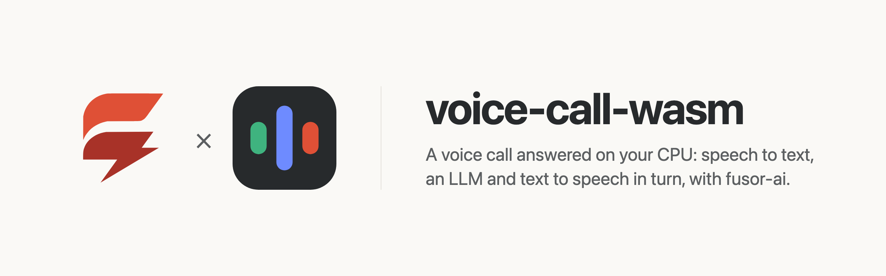
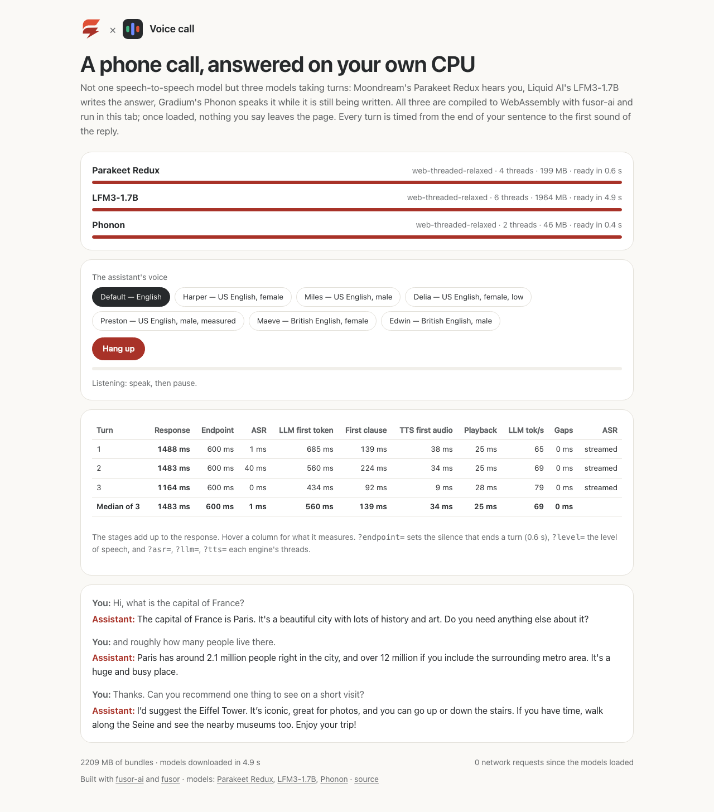

<p>
  <picture>
    <source media="(prefers-color-scheme: dark)" srcset="assets/brand/banner-dark.png">
    
  </picture>
</p>

# A voice call answered in the browser, on the CPU

**[Try it in your browser](https://huggingface.co/spaces/fusorlabs/voice-call-wasm)**: no install, no server. The models download once and run on your CPU.

**The reply starts 1.5 s after you stop talking**, 0.6 s of it the silence that tells the page your turn is over, in headless Chrome on an Apple M4 Pro: the median of a three-turn call, every stage measured. [How fast is it](#how-fast-is-it)



Talk to the page and it talks back. This is **not a speech-to-speech model**: it is three models working together, each compiled to its own WebAssembly runtime and run in its own worker. Moondream's [Parakeet Redux](https://huggingface.co/moondream/parakeet-redux) writes down what you say while you say it, Liquid AI's [LFM3-1.7B](https://huggingface.co/LiquidAI/LFM3-1.7B) writes the answer a token at a time, and Gradium's [Phonon](https://huggingface.co/gradium/phonon-31m-en) speaks each clause of it as soon as the clause is whole, while the rest is still being written. No server, no API key, no GPU required, and once the models have loaded, nothing you say leaves the page.

voice-call-wasm is the app around the models: a [fusor](https://github.com/fusor-rs/fusor) page that runs the call and times every turn. The models, compiled to WebAssembly, are built with [fusor-ai](https://github.com/fusor-rs/fusor-ai), the toolkit for AI runtimes in Rust and WebAssembly, from their published weights; each also has an app of its own ([parakeet-redux-wasm](https://github.com/fusor-rs/parakeet-redux-wasm), [liquidai-lmf3-wasm](https://github.com/fusor-rs/liquidai-lmf3-wasm), [phonon-wasm](https://github.com/fusor-rs/phonon-wasm)).

**In development · v0.1**: this is experimental software. See [status and known limitations](#status-and-known-limitations).

[Run it](#run-it-locally) · [Try it online](#try-it-online) · [How a call works](#how-a-call-works) · [How it works](#how-it-works) · [How fast is it](#how-fast-is-it) · [Status](#status-and-known-limitations)

## Run it locally

You need Rust 1.99 or newer, installed with [rustup](https://rustup.rs), Node.js 22 or newer and [`just`](https://github.com/casey/just). Then:

```sh
git clone --recurse-submodules https://github.com/fusor-rs/voice-call-wasm && cd voice-call-wasm
just ui
```

and open the address it prints in Chrome or Edge. `just ui` installs the pinned tools (the threads toolchain with rustup; wasm-bindgen, binaryen and the fusor CLI into `.tools/`), downloads the three checkpoints at pinned revisions (3.8 GB, each file sha256-checked), compiles them into 2.2 GB of bundles (199 MB, 1964 MB and 46 MB), builds each model's four browser runtimes (a few minutes the first time, seconds after) and the page, and serves it on `http://localhost:8787` with the bundles beside it. `CHECKPOINTS=<dir>` reuses checkpoints you already have, in `<dir>/parakeet-redux`, `<dir>/lfm3-1.7b` and `<dir>/phonon-31m-en`.

Pick the assistant's voice, press **Start call** and allow the microphone. Say something, then pause: after 0.6 s of silence your turn ends and the reply plays. When it has played, the page listens again; **Hang up** ends the call and forgets the conversation.

The page shows each turn's latency as it happens, split into the stages below, with their medians over the call, the conversation, and the network requests since the models loaded (they stay at zero). `?endpoint=0.4` ends a turn after a shorter silence, `?level=` sets how loud a frame must be to count as speech (an RMS of 0.015), and `?asr=`, `?llm=` and `?tts=` set each model's threads (4, 6 and 2).

## Try it online

Open the Hugging Face Space [fusorlabs/voice-call-wasm](https://huggingface.co/spaces/fusorlabs/voice-call-wasm) in Chrome or Edge. The page downloads the three models (2.2 GB) once from [fusorlabs/voice-call-wasm-web](https://huggingface.co/fusorlabs/voice-call-wasm-web) and keeps them in the browser's storage, so the next visit loads from this device.

## How a call works

<picture>
  <source media="(prefers-color-scheme: dark)" srcset="assets/flow/flow-dark.png">
  
</picture>

A turn's response is the time from the end of your speech to the first sound of the reply, and it is the sum of six stages, each the time between two moments the page marks:

| Stage | From | To |
| --- | --- | --- |
| Endpoint | the last voiced 20 ms frame | 0.6 s of silence after it, the end of your turn |
| ASR | the endpoint | the transcript: the last streamed one when it already covers the end of your speech, else Parakeet's `finish()` on the rest |
| LLM first token | the transcript | LFM3's first token, the prompt read (from where the conversation's kept prefix ends) |
| First clause | the first token | the first clause of four or more words, or the first sentence, written whole |
| TTS first audio | that clause sent to Phonon | its first 80 ms frame |
| Playback | the first frame | its first sample rendered, plus the output device's latency |

Gaps is the silence inside a reply while the voice waited for the LLM's next clause; LLM tok/s is the rate of the reply's tokens after the first.

## More ways to run it

### Build everything from source

```sh
just build    # also downloads the checkpoints (3.8 GB, sha256-checked) and compiles the bundles
just serve
```

### The checks

```sh
just smoke    # the three single-threaded runtimes chained in Node: LFM3 answers, Phonon speaks, Parakeet hears it back
just e2e      # a three-turn call in headless Chrome, a fake microphone speaking fixtures/caller.txt
```

`just e2e` speaks the caller's lines (Phonon's CLI says them into `fixtures/calls`, `just fixtures`), waits for each reply to play out, and checks that every turn was heard as it was said, answered and measured in every stage, that nothing was fetched during the call, and that a reload loads every model from the browser's storage. Each model's own repository checks it against its reference.

## How it works

- **Three models, three runtimes.** Each model is its own fusor-ai runtime in its own module worker, with its own thread pool; the page wires them together and holds the call. The models share nothing but the page's messages.
- **Heard while you speak.** The microphone's worklet streams 16 kHz audio straight to Parakeet's worker, which transcribes everything heard again every 0.5 s of new audio. When the turn ends, the last streamed transcript is usually already past the end of your speech and is used as it is; only otherwise does `finish()` read the rest.
- **The turn ends on silence.** The worklet judges each 20 ms frame voiced or not by its loudness; once you have spoken and then been quiet for 0.6 s, the floor closes. The call is half duplex: nothing is heard while the assistant speaks.
- **A conversation, not a string of prompts.** LFM3-1.7B keeps the call's conversation, so each turn reads only its new rows from where the last turn's prompt ended; a short system text asks for short, plain, spoken answers.
- **Spoken while it is written.** The reply is cut as it streams: its first clause once it has four words, then each sentence. Each piece goes to Phonon at once and its 80 ms frames play back to back, so the voice starts after the first clause, not after the reply.
- **Threads where the browser has them.** Each model picks one of its four builds: worker threads when the page is cross-origin isolated, relaxed SIMD when the engine supports it, plain SIMD128 everywhere else. The LLM and the voice run at the same time, so their threads (6 and 2 by default) stay below the cores.
- **Downloaded once, verified always.** Each bundle streams in parts, each checked against its BLAKE3 hash, and stays in the browser's origin-private storage, so the next visit loads from this device.
- **Sealed.** No runtime imports a network, storage, clock or entropy capability; fusor-ai's import check proves it on every build. The page counts the engines' network requests during the call, and the count is zero.

## How fast is it

On an Apple M4 Pro in headless Chrome (`web-threaded-relaxed`, 4 threads for Parakeet Redux, 6 for LFM3-1.7B, 2 for Phonon), one `just e2e` call of three turns:

| Turn | Response | Endpoint | ASR | LLM first token | First clause | TTS first audio | Playback | LLM tok/s | Gaps |
| --- | --- | --- | --- | --- | --- | --- | --- | --- | --- |
| 1 | 1488 ms | 600 ms | 1 ms | 685 ms | 139 ms | 38 ms | 25 ms | 65 | 0 ms |
| 2 | 1483 ms | 600 ms | 40 ms | 560 ms | 224 ms | 34 ms | 25 ms | 69 | 0 ms |
| 3 | 1164 ms | 600 ms | 0 ms | 434 ms | 92 ms | 9 ms | 28 ms | 79 | 0 ms |
| **Median** | **1483 ms** | 600 ms | 1 ms | 560 ms | 139 ms | 34 ms | 25 ms | 69 | 0 ms |

After the endpoint's silence, the LLM's prompt and first token is the largest stage; every transcript was already streamed when the turn ended, Phonon's first frame takes tens of milliseconds, and no reply stalled waiting for text. The three bundles load in 5.1 s from localhost and in 2.8 s from the browser's storage on a revisit. Single-threaded in Node, relaxed SIMD, the same chain answers the first line in 1.9 s (38 tokens), speaks the 9.0 s answer in 0.8 s and hears it back in 1.1 s, word for word.

These are the figures of one run (a fresh profile, other work on the machine), with a caller spoken by Phonon itself; a person's voice, a room and a microphone add their own latency before the first frame the page hears.

## Documentation

| Guide | Covers |
| --- | --- |
| [AGENTS.md](AGENTS.md) | The code standard every change follows |
| [parakeet-redux-wasm](https://github.com/fusor-rs/parakeet-redux-wasm), [liquidai-lmf3-wasm](https://github.com/fusor-rs/liquidai-lmf3-wasm), [phonon-wasm](https://github.com/fusor-rs/phonon-wasm) | Each model on its own: its page, its CLI, its checks against its reference and its benchmarks |

## Status and known limitations

voice-call-wasm is v0.1 and experimental.

| Platform or capability | Status |
| --- | --- |
| Chrome and Edge, threads and relaxed SIMD | Headless Chrome end-to-end check (`just e2e`): a three-turn call from a fake microphone, revisit |
| Browsers without relaxed SIMD (Safari, older Firefox) | SIMD128 builds, checked in Node (`just smoke`); not tested in those browsers |
| Pages without cross-origin isolation | Single-threaded builds |
| A real microphone in a room | Not measured; `?level=` may need raising in a noisy room |
| Phones | Not measured; the LLM's threaded builds' memory may grow to 4 GB |

**Not supported yet:**

- Interrupting the assistant: the call is half duplex, and the microphone is closed while the reply plays.
- Ending a turn on anything but silence: a pause of 0.6 s mid-sentence ends it too.
- A voice in languages other than English: Phonon speaks English only.
- A GPU backend.

The models are Moondream's [Parakeet Redux](https://huggingface.co/moondream/parakeet-redux), from NVIDIA's [parakeet-tdt-0.6b-v3](https://huggingface.co/nvidia/parakeet-tdt-0.6b-v3) (CC-BY-4.0); Liquid AI's [LFM3-1.7B](https://huggingface.co/LiquidAI/LFM3-1.7B), under the LFM Open License v1.0, whose license the bundle ships beside its weights (`model/lfm3-1.7b/LICENSE`); and Gradium's [Phonon](https://huggingface.co/gradium/phonon-31m-en) with its catalog voices, Apache-2.0. The Space loads the bundles from [fusorlabs/voice-call-wasm-web](https://huggingface.co/fusorlabs/voice-call-wasm-web).

## License

The code is licensed under the [MIT License](LICENSE). The models' weights are their authors', under their own licenses.
